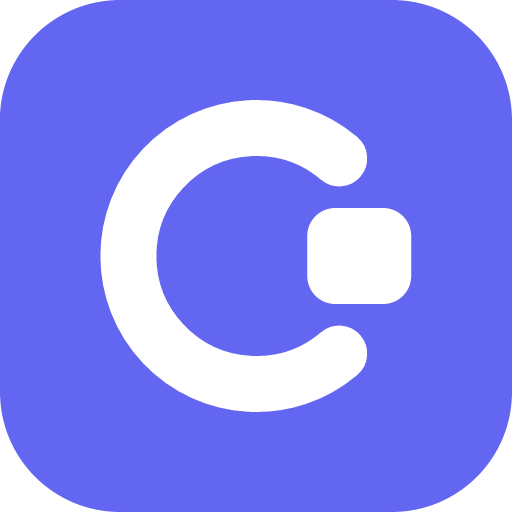

<p align="center">
  
  <h1 align="center">Cortex</h1>
</p>

A focused daily planner built as a native macOS desktop app. Cortex helps you capture tasks, schedule your week, visualise priorities with an Eisenhower matrix, and time-block your day — all in one place.

---

## Features

### Quick add in plain language
Press **N** (or click the add box in the sidebar) and the box grows into the middle of the screen. Type the task the way you'd say it; Cortex picks out the details, colours them as you type and shows them as chips underneath:

```
Call Ali tomorrow 10.30pm 45m #work p1
Spor her gün akşam 7
Rapor haftaya salı 2 saat !yüksek
```

| What | Examples |
|---|---|
| Day | `today`, `tomorrow`, `friday`, `next friday`, `in 3 days`, `next week`, `3 dec`, `12.05` · `bugün`, `yarın`, `cuma`, `haftaya salı`, `3 gün sonra`, `gelecek ay` |
| Time | `14:00`, `14.30`, `3pm`, `10.30pm`, `at 9` · `saat 3`, `sabah 9`, `akşam 8`, `gece 11` |
| Duration | `45m`, `1h30m`, `1.5h` · `45dk`, `2 saat` |
| Priority | `p1` `p2` `p3`, `!high`, `!!`, `!yüksek` |
| Label | `#work` — typing `#` lists your labels; a new name creates a label |
| Repeat | `every day`, `weekdays`, `every week`, `every monday` · `her gün`, `hafta içi`, `her hafta` |

A time puts the task straight into the timebox.

### Brain Dump
A frictionless inbox for everything on your mind. From there, drag a task onto a day, a quadrant or a timebox slot.

### Week, Month and Focus views
- **Week** — a column per day, with that day's calendar events at the top. Drag tasks between days.
- **Month** — the whole month at a glance: planned tasks, calendar events and **due dates** (🚩) on each day, with a done counter. Click a day to show it in the timebox, double-click to open its week.
- **Focus** — today's list, the Eisenhower matrix and the timebox side by side.

Switch with the segmented control or `V`.

### Plan my day
The wand in the timebox fills the day's unscheduled tasks into free time between calendar events and existing blocks, inside your work hours:
- higher priority first, and within a priority the **shorter task first**;
- a **break** between tasks and around events (30 min by default);
- optionally a short **warm-up** task (≤ 30 min) before the most important one.

The eraser next to it empties the day's timebox again so you can re-plan. Both undo in one step.

### Eisenhower Matrix
Do First · Schedule · Delegate · Eliminate, for **Today**, **This week** (default) or **All** open tasks.
Tasks you haven't sorted are placed automatically from their priority and due date (marked *Auto*) — important = high/medium priority, urgent = due by tomorrow; tasks with neither aren't guessed. Dragging a card makes its place permanent; the eraser clears the whole matrix.

### Timebox
A 06:00–24:00 grid with 15-minute slots. Drag tasks in, resize blocks from their bottom edge, see the current time. Calendar events are hatched so they never look like tasks; overlapping items sit side by side.

### Repeating tasks
Set *Repeat* (every day, weekdays, every week) in the task panel or type it. Checking one off creates the next occurrence.

### Never lose a task
- **Unfinished tasks** from earlier days are offered to move to today, once a day.
- **Undo** (`⌘Z`) reverts adds, edits, moves, completions and deletes; batch actions undo in one step.

### Command palette
`⌘K` searches tasks (accent-insensitive) and runs commands; type a day (`friday`, `3.12`) to jump to it.

### Stats
Today's done / planned, time blocked vs. estimated, your streak, a 7-day chart and how your estimates compare with how long tasks actually took.

### Reminders and menu bar
A macOS notification before each timebox starts, and the current or next block next to the clock in the menu bar. Both can be switched off separately.

### Task Detail Panel
Click a task title: edit the title, due date, estimate (`1h 30m`), priority, label, repeat and notes.

---

## Settings

Open settings via the **⚙** icon (or press `,`).

### General
| Setting | Options | Default |
|---|---|---|
| Language | English / Türkçe | English |
| Start of week | Monday / Sunday | Monday |
| Default view | Week / Month / Focus | Week |
| Time format | 24h / 12h | 24h |
| Date format | DD/MM/YYYY / MM/DD/YYYY / YYYY-MM-DD | DD/MM/YYYY |

### Appearance
| Setting | Options | Default |
|---|---|---|
| Theme | System / Light / Dark | System |
| Accent colour | Indigo, Blue, Cyan, Emerald, Rose, Orange, Pink, Slate | Indigo |

### Planning
| Setting | Options | Default |
|---|---|---|
| Work hours | 00:00–23:00 | 09:00–18:00 |
| Break between tasks | None / 10 / 15 / 30 min | 30 min |
| Start with a warm-up | On / Off | On |
| Timebox reminders | On / Off, 5 / 10 / 15 min before | On, 5 min |
| Show in menu bar | On / Off | On |

### Shortcuts
Overview of all single-key shortcuts (see table below).

### Update
Manually check for a new version and install it in-app without going to the browser.

### Integrations
Show events from your calendars (read-only) in the Timebox, next to your timeboxed tasks. Overlapping events and tasks are laid out side by side; all-day events appear as chips under the date.
- **iCloud Calendar** — Apple ID + an [app-specific password](https://appleid.apple.com) (Sign-In and Security → App-Specific Passwords).
- **Google Calendar** — sign in with Google in your browser. Several Google accounts can be connected.

Per calendar you can toggle visibility and change the colour. Recurring events, time zones / DST and declined invitations (Google) are handled. Passwords and tokens are stored in `secrets.json` in the app's data folder (readable only by your user), never in the webview's local storage. The macOS Keychain is not used because, without a Developer ID signature, it would ask for your login password after every update.

All settings persist across sessions.

---

## Keyboard Shortcuts

| Key | Action |
|---|---|
| `N` | New task (the add box grows into the middle) |
| `⌘K` | Search and commands |
| `⌘Z` | Undo |
| `P` | Plan my day |
| `V` | Switch view (Week / Month / Focus) |
| `B` | Toggle Brain Dump sidebar |
| `T` | Toggle Timebox panel |
| `,` | Open settings |
| `Esc` | Close panel / overlay |

> Single-key shortcuts fire only when no text input is focused.

---

## Auto-Update

Cortex checks for updates on launch and every time the app is focused after being in the background. When an update is available, a banner appears in the bottom-right corner. You can also check manually via **Settings → Update**.

### macOS Gatekeeper Warning

If you see *"Cortex is damaged and can't be opened"* after downloading, run this in Terminal:

```
xattr -dr com.apple.quarantine /Applications/Cortex.app
```

This is expected for apps not signed with an Apple Developer certificate.

---

## Drag & Drop Rules

| Source | Valid Drop Targets |
|---|---|
| Brain Dump task | Day column, month day, Eisenhower quadrant, Timebox slot, Brain Dump (unschedule) |
| Month day task | Another month day, Timebox slot, Brain Dump |
| Focus list task | Eisenhower quadrant, Timebox slot |
| Eisenhower card (`eis::`) | Other Eisenhower quadrants only |
| Timebox block (`tb::`) | Other Timebox slots only |

---

## Tech Stack

| Layer | Technology |
|---|---|
| Desktop shell | [Tauri 2](https://tauri.app) (Rust) |
| UI framework | [React 19](https://react.dev) + [TypeScript](https://www.typescriptlang.org) |
| Build tool | [Vite 7](https://vitejs.dev) |
| Styling | [Tailwind CSS v4](https://tailwindcss.com) |
| State management | [Zustand](https://zustand-demo.pmnd.rs) with `persist` middleware |
| Drag & drop | [@dnd-kit/core](https://dndkit.com) |
| Animations | [Framer Motion](https://www.framer.com/motion) |
| Date utilities | [date-fns](https://date-fns.org) |
| Database | SQLite via `tauri-plugin-sql` |
| Auto-update | `tauri-plugin-updater` + `tauri-plugin-process` |
| i18n | Custom lightweight translation system + date-fns locales |

---

## Project Structure

```
src/
├── components/
│   ├── brain-dump/       # BrainDump, TaskItem, TaskInput, TaskDetailPanel
│   ├── common/           # CommandPalette, SmartInput, ParsePreview, StatsDialog, Toaster, RolloverBanner, pickers
│   ├── eisenhower/       # EisenhowerMatrix, Quadrant
│   ├── layout/           # AppShell, SettingsButton
│   ├── monthly/          # MonthView
│   ├── quick/            # QuickOverlay (the N add box)
│   ├── settings/         # SettingsPanel (modal), IntegrationsSection
│   ├── timebox/          # Timebox, TimeboxBlock, TimeSlot
│   ├── today/            # TodayFocus, TodayTaskList
│   ├── updater/          # UpdateBanner
│   └── weekly/           # WeeklyTimeline, WeekNav, DayColumn
├── hooks/
│   ├── useDateLocale.ts  # Returns date-fns locale based on language setting
│   ├── useBackground.ts  # Timebox reminders + menu bar status
│   ├── useDayEvents.ts   # Calendar events for one day (all accounts)
│   ├── useDragDrop.ts    # Centralised drag-end handler
│   ├── useIsDark.ts      # Reactive dark-mode detector
│   ├── useT.ts           # Translation hook
│   └── useUpdater.ts     # Auto-update check + install logic
├── i18n/
│   └── index.ts          # EN / TR translation dictionaries
├── store/
│   ├── generalStore.ts   # Language, week start, views, planning and reminder settings
│   ├── integrationStore.ts # Calendar accounts, calendars, cached events per month
│   ├── labelStore.ts     # User-defined labels
│   ├── quickStore.ts     # The N add box
│   ├── toastStore.ts     # Toasts (with Undo)
│   ├── taskStore.ts      # Tasks, undo history, repeats, view state, navigation
│   └── themeStore.ts     # Theme, accent colour, CSS variable application
├── types/
│   └── index.ts
└── lib/
    ├── actions.ts        # Quick add, plan my day, clear, rollover, undo
    ├── calendarEvents.ts # Event → local day slices, month bounds
    ├── db.ts             # Tauri SQLite helpers
    ├── eisenhower.ts     # Quadrant suggestions and matrix scopes
    ├── parseTask.ts      # Natural-language task parsing (EN + TR)
    ├── planDay.ts        # Plan my day placement
    ├── recurrence.ts     # Next occurrence of a repeating task
    └── time.ts           # Timebox grid constants, HH:MM helpers, column layout

src-tauri/src/
├── lib.rs                # Tauri builder + command registration
├── caldav.rs             # iCloud CalDAV client
├── ical.rs               # iCalendar parsing + recurrence expansion
├── google.rs             # Google OAuth (loopback + PKCE) and Calendar API
├── secrets.rs            # Credential store (app data dir, 0600)
├── desktop.rs            # Menu bar item
└── events.rs             # Shared event type
```

---

## Development

### Prerequisites
- [Node.js](https://nodejs.org) ≥ 20
- [Rust](https://www.rust-lang.org/tools/install) + `cargo`
- [pnpm](https://pnpm.io)

```bash
# Install dependencies
pnpm install

# Run in development (hot-reload)
pnpm tauri dev

# Build for production
pnpm tauri build

# Tests (frontend + Rust)
pnpm test
cd src-tauri && cargo test
```

The Vite dev server runs on `http://localhost:1420`.

### Google Calendar setup
The Google OAuth client is compiled into the app. Without it the app works, and the Google button says it is not configured.

1. In [Google Cloud Console](https://console.cloud.google.com), create a project and enable the **Google Calendar API**.
2. Configure the **OAuth consent screen** (External) with the scopes `openid`, `email` and `.../auth/calendar.readonly`, then **publish it to production**: in *Testing* mode refresh tokens expire after 7 days. Until the app is verified, Google shows an "unverified app" warning (fine for personal use, up to 100 users).
3. Create an **OAuth client ID** of type **Desktop app**.
4. Put the values in `src-tauri/.env` (git-ignored) for local builds:
   ```
   GOOGLE_CLIENT_ID=xxxx.apps.googleusercontent.com
   GOOGLE_CLIENT_SECRET=xxxx
   ```
   and add the same two names as GitHub repository secrets for release builds.

---

## License

MIT
